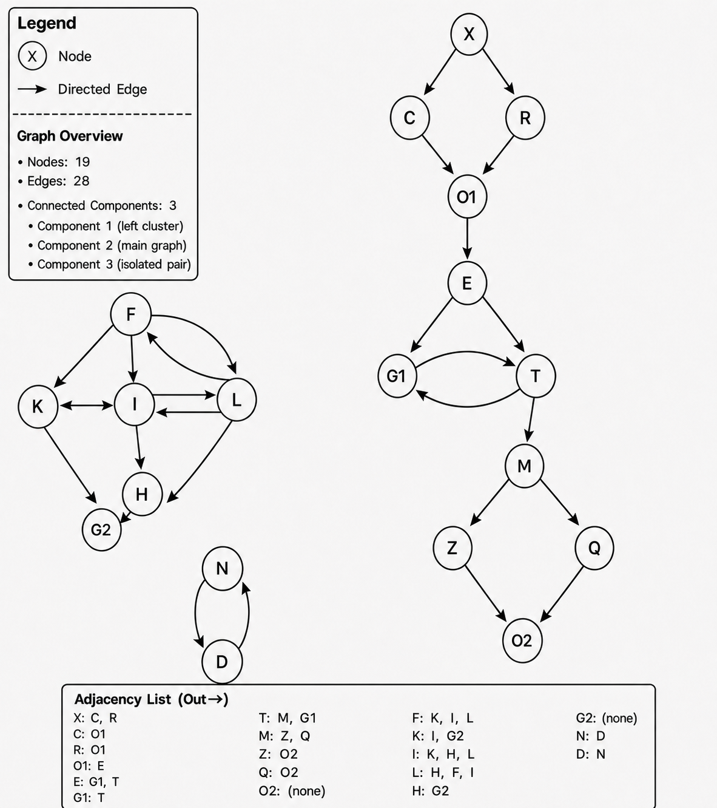

# MMG Graph Search Example

A standalone C++20 graph library and demonstration inspired by the traversal
concepts used in Mental Model Graph (MMG). It demonstrates two classic ways to
find a path through directed or undirected graphs:

- **Breadth-first search (BFS)** explores level by level and returns a shortest
  path in an unweighted graph.
- **Depth-first search (DFS)** follows one branch as far as possible before
  backtracking.

The graph also exposes its structure, deterministic visitation order, and the
number of examined edges, making the algorithms easy to inspect rather than
treating them as black boxes.

This repository is intentionally independent of the private MMG codebase and
has no third-party dependencies.

## Example graph

This is the original MMG reference fixture: 19 nodes, 28 directed edges, and
three disconnected islands.



With neighbors visited in insertion order:

```text
MMG Reference Graph
===================
19 nodes | 28 directed edges

Nodes and outgoing edges
------------------------
  [X] -> [C]  [R]
  [C] -> [O1]
  [R] -> [O1]
  ...

Islands
-------
  Island 1 (11 nodes): [X] [C] [R] [O1] [E] [G1] [T] [M] [Z] [Q] [O2]
  Island 2 (6 nodes): [F] [K] [I] [L] [G2] [H]
  Island 3 (2 nodes): [N] [D]

Breadth-first search: X to O2
-----------------------------
  Path: [X] -> [C] -> [O1] -> [E] -> [T] -> [M] -> [Z] -> [O2]

Depth-first search: X to O2
---------------------------
  Path: [X] -> [C] -> [O1] -> [E] -> [T] -> [M] -> [Z] -> [O2]
```

## Graph API

`Graph` supports:

- directed and undirected edges;
- duplicate-safe node and edge insertion;
- node, edge, and neighbor inspection;
- edge-existence queries;
- weakly connected component ("island") discovery;
- BFS and DFS path finding;
- deterministic traversal traces and examined-edge counts;
- cycle-safe searches and explicit not-found results.

## Build and run

You need CMake 3.16 or newer and a compiler with C++20 support.

```sh
cmake -S . -B build
cmake --build build
./build/mmg_graph_example
```

Run the tests:

```sh
ctest --test-dir build --output-on-failure
```

Visual Studio can open this folder directly. Select `mmg_graph_example` as the
startup target and press **Run**.

## Project layout

```text
include/mmg_example/graph.hpp  Public graph API
include/mmg_example/reference_graph.hpp  Original MMG reference fixture
src/graph.cpp                  BFS and DFS implementations
src/main.cpp                   Runnable example
tests/graph_tests.cpp          Lightweight behavior tests
```

## Design notes

- Nodes are identified by strings so the examples read like a software graph.
- Graphs are directed by default and can be constructed as undirected.
- Duplicate nodes and edges are ignored and reported by the insertion methods.
- Traversal order is deterministic: neighbors are considered in insertion order.
- Detailed searches return the path, visit order, and examined-edge count.
- Convenience path methods return `std::nullopt` when no path exists.
- BFS and DFS are iterative, avoiding recursion-depth limits on large graphs.

## Test coverage

The dependency-free test executable checks graph metadata, duplicate handling,
directed and undirected behavior, shortest-path BFS, branch-first DFS, cycles,
unreachable nodes, self-paths, traversal order, and search diagnostics. It also
adapts MMG's original reference fixture: 19 nodes and 28 directed edges must be
separated into the expected islands of 11, 6, and 2 nodes.

## Usage

This repository is published as a portfolio and educational showcase. Schools,
students, teachers, researchers, charities, hobbyists, and others may use,
modify, and share it for non-commercial purposes under the project’s
[short usage notice](LICENSE).

Commercial use requires prior written permission—please ask first. The project
is provided **as is**, without warranty or liability.
